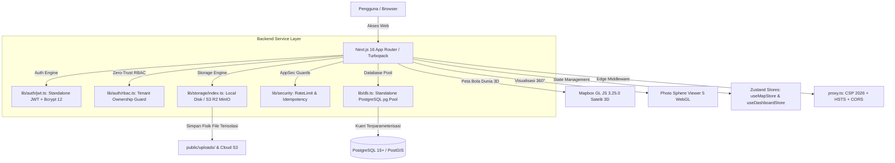

# SYSTEM SPECIFICATION & PRODUCT REQUIREMENT DOCUMENT (PRD)
# view360 — Web-GIS 3D Spatial Visualization & Multi-Tenant Panorama Monitoring Platform

**Dokumen:** PRD.md / SYSTEM_SPECIFICATION.md  
**Versi Produk:** `1.2.0` (Decoupled Standalone Architecture & OWASP 2026 Hardened)  
**Status Sistem:** **Production Ready** (Next.js 16.2.9 Turbopack Build Passed, Exit Code 0)  
**Arsitektur:** Next.js 16.2.9 App Router + React 19 + Mapbox GL JS 3D + Photo Sphere Viewer WebGL + Standalone PostgreSQL/pg + Standalone Storage + Tailwind CSS v4  

---

> [!CRITICAL]
> ### ATURAN MUTLAK ANTARMUKA & TIPOGRAFI
> 1. **Dilarang Keras Menggunakan ALL CAPS:** Tidak boleh ada teks tombol, label formulir, heading, badge, atau modal yang ditulis kapital semua. Gunakan **Sentence case** untuk aksi dan deskripsi, atau **Title Case** yang wajar untuk nama entitas.
> 2. **Dilarang Utilitas Tailwind `uppercase`:** Dilarang keras menggunakan class `uppercase` maupun CSS `text-transform: uppercase`.
> 3. **Panduan Desain Tailwind v4:**
>    - Modifikator `dark:` hanya digunakan untuk warna (`dark:bg-*`, `dark:text-*`, `dark:border-*`).
>    - Desain tema terang (*light theme*) harus bersih, flat, dengan `shadow-none` pada komponen struktural (sidebar, tabel, kartu) dan subtle border `border-slate-200`.
>    - Kotak modal (*modal box base*) wajib berlatar `bg-white` pada light mode.

---

## 1. Ringkasan Eksekutif & Tujuan Produk

**view360** adalah platform visualisasi spasial berbasis Web-GIS tingkat lanjut yang menggabungkan kemegahan visual bola dunia 3D (*3D Satellite Globe*), peta mini 2D, dan penampil foto panorama 360° interaktif (*Photo Sphere Viewer*).

Platform ini dirancang khusus untuk memenuhi kebutuhan pemantauan aset infrastruktur, proyek survei kehutanan/perkebunan, inspeksi menara telekomunikasi, dan pemantauan batas konsesi wilayah dengan dukungan **Multi-Tenant Strict Isolation** di mana berbagai perusahaan dapat menggunakan satu sistem tanpa risiko kebocoran data antar-perusahaan.

Pada versi **1.2.0**, sistem telah sepenuhnya **didekoupel (*decoupled*)** menjadi arsitektur mandiri (*standalone*) menggunakan koneksi pool PostgreSQL terparameterisasi, otentikasi JWT HS256 mandiri, abstraksi penyimpanan berkas mandiri (Local Disk & S3-Compatible), serta penerapan standar keamanan **OWASP 2021–2026**.

---

## 2. Arsitektur Teknis Sistem



### Komponen Inti:
1. **Frontend Runtime:**
   - Next.js 16.2.9 dengan Turbopack untuk kompilasi ultra cepat.
   - React 19.2.4 & TypeScript 5.x.
   - Tailwind CSS v4 dengan sistem token kustom di `globals.css` (Glassmorphism, Dark/Light mode, Sentence Case).
   - Global UI Component System di `components/ui/GlobalComponents.tsx` (`Button`, `Input`, `Select`, `Badge`, `Card`, `EmptyState`, `ConfirmDialog`).
2. **Geospatial & Visualization Engines:**
   - **Mapbox GL JS 3.25.0:** Rendering peta globe 3D satelit, clustering dinamis berbasis densitas titik, floating HTML markers, dynamic layer stacking di bawah titik foto node.
   - **Photo Sphere Viewer 5.14.3:** WebGL equirectangular projection, rotasi bebas 360°, preloading node tetangga, pembersihan memory leak.
   - **Turf.js (`@turf/area`, `@turf/helpers`):** Kalkulasi luas poligon akurat dalam Hektar (`ha`).
   - **Shpjs & toGeoJSON:** Konversi instan berkas Shapefile (.zip), KML, dan GeoJSON ke format standar.
3. **Backend & Database:**
   - Standalone PostgreSQL pool (`lib/db.ts`) dengan proteksi injeksi SQL 100% parameterised.
   - Next.js Route Handlers (`app/api/`) tipis yang mendelegasikan logika ke service layer terproteksi `server-only`.

---

## 3. Matriks Hak Akses (RBAC) & Multi-Tenant Isolation

Sistem membagi pengguna ke dalam 4 level hak akses terenkapsulasi:

```
[SISTEM WEB-GIS]
  ├── Super Admin (`superadmin`) : Pemantau helikopter global seluruh perusahaan, kelola akun admin & direktori klien.
  ├── Admin Perusahaan (`admin`)  : Pemilik kelompok perusahaan (*Company Owner*). Mengelola staf, seksi, batas, dan foto node.
  ├── User / Staf (`user`)        : Staf operasional lapangan di bawah Admin Perusahaan (`parent_admin_id`).
  └── Tamu Publik (Anonim)        : Mengakses via rute publik perusahaan `/[adminId]`.
```

### Matriks Otorisasi Fungsional:

| Kemampuan / Fitur | Super Admin | Admin Perusahaan | User / Staf Perusahaan | Tamu Publik (`/[adminId]`) |
| :--- | :---: | :---: | :---: | :---: |
| **Lihat Seluruh Data Perusahaan** | Ya | Tidak (Hanya miliknya) | Tidak (Hanya miliknya) | Tidak (Hanya 1 Perusahaan) |
| **Kelola Akun Pengguna (`/dashboard/users`)** | Ya | Ya (Staf perusahaannya) | Tidak | Tidak |
| **Unggah Foto 360° (*Smart Uploader*)** | Ya | Ya | Ya | Tidak |
| **Edit / Hapus Foto Node** | Ya | Ya (Milik perusahaannya) | Terbatas/Sesuai Izin | Tidak |
| **Unggah & Kelola Batas Wilayah** | Ya | Ya (Milik perusahaannya) | Hanya Lihat | Hanya Lihat (Jika Terbit) |
| **Ubah Warna & Opacity Poligon Batas** | Ya | Ya | Tidak | Tidak |
| **Hapus Poligon Batas Wilayah** | Ya | Ya (Terkunci `groupUserIds`)| Tidak | Tidak |
| **Kelola Profil Perusahaan (Logo, Nama)** | Ya | Ya (Perusahaan sendiri) | Tidak | Tidak |
| **Kelola Seksi / Sektor Wilayah** | Ya | Ya (Terkunci `groupUserIds`)| Tidak | Tidak |
| **Pemindai Titik Duplikat** | Ya | Ya (Dalam perusahaannya)| Tidak | Tidak |

---

## 4. Spesifikasi Rinci Modul Fungsional & Optimasi Kinerja

### Modul 1: 3D Interactive Satellite Globe (`MapboxGlobe.tsx`, `useMapbox.ts`, & `useMapboxBoundaries.ts`)
- **Dynamic Clustering & Layer Stacking:** Titik node dikelompokkan secara visual. Poligon batas wilayah di-render **DI BAWAH (BELAKANG)** titik foto node (`beforeLayerId: 'clusters'`).
- **Click Event Collision Guard:** Pemeriksaan fitur titik via `queryRenderedFeatures` agar klik pada lingkaran node tidak memicu pop-up poligon batas wilayah.
- **Selective Boundary Fetching:** API `/api/dashboard/boundaries` hanya menyertakan properti GeoJSON lengkap jika diminta oleh kanvas peta via query parameter `?include_geojson=true`. Pemanggilan daftar ringkasan di dashboard memotong muatan data hingga 95% lebih hemat bandwidth.
- **WebGL Context Lifecycle Management:** Pembersihan eksplisit event listener dan eksekusi `map.remove()` pada saat unmount untuk mencegah kebocoran konteks WebGL browser.

### Modul 2: 360° Panorama Viewer (`Viewer360.tsx`)
- **Proyeksi Equirectangular:** Rendering gambar rasio 2:1 ke dalam bola panorama WebGL yang dapat digeser dan diperbesar secara intuitif.
- **Adjacent Node Preloading:** Memuat gambar node tetangga secara asinkron di memori latar belakang untuk transisi instan saat berpindah stasiun.
- **Blob URL Lifecycle:** Memanggil `URL.revokeObjectURL()` saat penampil ditutup untuk membebaskan RAM peramban.

### Modul 3: Smart Photo Uploader (`SmartUploader.tsx`, `usePanoramaUploader.ts`)
- **Upload Concurrency Queue:** Memproses kompresi dan pengunggahan maksimal 2 berkas secara simultan (`MAX_CONCURRENT_UPLOADS = 2`) untuk mencegah browser crash saat pengguna menyeret puluhan foto resolusi tinggi.
- **Magic-Bytes Verification:** Memeriksa signature biner asli gambar (JPEG `FF D8 FF`, PNG `89 50 4E 47`, WEBP `RIFF...WEBP`) untuk menangkal serangan file spoofing.
- **Ekstraksi EXIF Otomatis:** Mengambil koordinat GPS (Latitude, Longitude) dan tanggal pengambilan foto menggunakan `exifr`.
- **Kompresi Gambar Sisi Klien:** Memperkecil berkas resolusi tinggi (maks 5MB, resolusi maks 4096px) menggunakan Web Worker `browser-image-compression`.
- **Idempotency Guard:** Menyematkan header `X-Idempotency-Key` untuk mencegah duplikasi unggahan berkas akibat klik berulang.

### Modul 4: Company Boundary Layer Management (`ManageBoundariesModal.tsx` & `/api/dashboard/boundaries`)
- **Multi-Format Ingestion:** Menerima file GeoJSON, KML, dan ZIP Shapefile (.shp, .dbf, .shx, .prj).
- **Kalkulasi Otomatis Luas Hektar:** Menghitung total luas poligon secara akurat menggunakan algoritma geodesik Turf.js (`@turf/area`).
- **Styling Dinamis:** Setiap layer memiliki nama kustom, warna batas (*hex color picker*), tingkat transparansi (*opacity slider* 0–100%), dan sakelar visibilitas (*visibility toggle*).
- **Sanitasi Properti Fitur:** Seluruh teks properti poligon disanitasi dari tag berbahaya via `sanitizeHtmlString()` sebelum ditampilkan pada popup peta.

### Modul 5: Log Lokasi Sidebar (`MapSidebar.tsx`)
- **Dekomposisi Modular:** Terpecah menjadi `SidebarBoundariesAccordion.tsx` (75 baris) dan `SidebarNodeList.tsx` (90 baris).
- **Integritas Jumlah Kartu:** Menampilkan seluruh titik foto individual tanpa deduplikasi paksa nama lokasi, sehingga jumlah total titik di dashboard selalu sama persis dengan jumlah kartu log lokasi di sidebar.
- **Pencarian & Filter Sektor:** Pencarian instan berdasarkan nama stasiun dan filter dropdown seksi/sektor perusahaan.

---

## 5. Standar Keamanan & Perlindungan (OWASP 2021–2026)

| Kode OWASP | Kerentanan | Penanganan di view360 (v1.2.1) |
| :--- | :--- | :--- |
| **A01:2021 & API1** | Broken Access Control / BOLA | Validasi kepemilikan tenant server-side via `verifyTenantOwnership()` & `requireAuth()` di `lib/auth/rbac.ts`. |
| **A02:2021** | Cryptographic Failures | Standalone JWT HS256 (`jose`) dengan signing key minimum 32 karakter + Bcrypt cost factor 12 di `lib/auth/jwt.ts`. |
| **A03:2021** | Injection | Kueri SQL 100% menggunakan *parameterized queries* (`query(sql, [params])`) di `lib/db.ts`. |
| **A03:2021** | Stored DOM XSS | Sanitasi EXIF dan atribut GeoJSON via `sanitizeHtmlString()` di `lib/validations/security.ts`. |
| **A04 & A08** | Insecure Design & File Spoofing | Validasi *magic bytes* biner asli (`validateFileMagicBytes`) sebelum berkas disimpan. |
| **A05:2021** | Security Misconfiguration | HTTP 2026 Security Headers di `proxy.ts` (CSP ramah WebGL Mapbox/PSV, HSTS, X-Frame-Options SAMEORIGIN). |
| **A07 & API4** | Rate Limiting | Sliding-window rate limiter di `lib/security/rateLimit.ts` membatasi login (5/min) dan upload (30/min). |
| **API3:2023** | BOPLA / Mass Assignment | Skema validasi Zod ketat (`.strict()`) di `lib/validations/security.ts`. |
| **A10 & API7** | Server-Side Request Forgery | Proteksi `isSafeExternalUrl()` memblokir request ke localhost, AWS metadata `169.254.169.254`, dan IP private RFC 1918. |
| **Resiliency** | Double-Submit Network Retry | `X-Idempotency-Key` guard di `lib/security/idempotency.ts` mencegah duplikasi transaksi. |

---

## 6. Skema Basis Data Mandiri (PostgreSQL)

Skema database PostgreSQL mandiri terdefinisi pada [`database/migrations/001_initial_standalone.sql`](file:///c:/Users/BILALIHSAN/Documents/project/web-gis/database/migrations/001_initial_standalone.sql):

1. **`user_roles`**: `user_id` (UUID PK), `email` (TEXT UNIQUE), `password_hash` (TEXT), `role` (TEXT), `parent_admin_id` (UUID), `company_name` (TEXT), `company_slug` (TEXT UNIQUE), `company_description` (TEXT), `company_logo` (TEXT).
2. **`company_sections`**: `id` (UUID PK), `name` (TEXT), `created_by` (UUID REFERENCES `user_roles(user_id)`).
3. **`company_boundaries`**: `id` (UUID PK), `name` (TEXT), `geojson` (JSONB), `color` (TEXT), `opacity` (FLOAT), `is_visible` (BOOLEAN), `total_area_ha` (FLOAT), `created_by` (UUID REFERENCES `user_roles(user_id)`).
4. **`locations`**: `id` (UUID PK), `name` (TEXT), `slug` (TEXT UNIQUE), `section_id` (UUID REFERENCES `company_sections(id)`), `created_by` (UUID REFERENCES `user_roles(user_id)`).
5. **`spatial_nodes`**: `id` (UUID PK), `location_id` (UUID REFERENCES `locations(id)`), `latitude` (FLOAT8), `longitude` (FLOAT8), `image_url` (TEXT), `is_published` (BOOLEAN), `capture_date` (DATE), `created_by` (UUID REFERENCES `user_roles(user_id)`).
